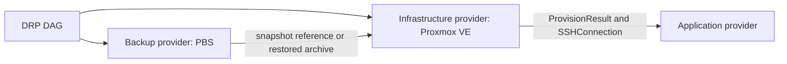

# drtui architecture

The current application is a .NET 10 Spectre.Console CLI. The plan loader and
readiness checks live in [Plan.cs](../Plan.cs) and [Session.cs](../Session.cs);
the standalone PBS command adapter lives in [PbsClient.cs](../PbsClient.cs).
The execution package, scheduler, provider host, journal, and protocol below
describe future work, not supported CLI capabilities.

## Design constraints

drtui is a stateless orchestrator. A run consumes one immutable `.drp`
execution package, holds transient state in memory, and emits an append-only run
journal to a caller-selected path or stdout. It has no control-plane database,
daemon, or implicit remote state.

Plan preparation is distinct from execution: guided setup saves explicit,
non-secret local drafts in a user-restricted application-data directory and
can publish them to an explicitly confirmed private GitHub repository. These
editable drafts are not journals, resumable execution state, or immutable
signed packages. Credentials remain in the keyvault, vendor CLI credential
stores, or process-only bootstrap environment, never in the saved plan.

The same package, inputs, provider binaries, and external starting state must
produce the same action graph and invocation payloads. External systems can
still change independently, so providers must implement idempotency and report
observed state explicitly.

## Repository layout

The current .NET implementation lives at the repository root:

```text
drtui/
|-- Drtui.csproj                    .NET 10 console application
|-- Program.cs                      CLI entry point and local readiness view
|-- Plan.cs                         YAML, schema, and dependency validation
|-- PlanPicker.cs                   Interactive plan browser
|-- PlanPreview.cs                  Plan summaries for the browser
|-- Session.cs                      Inputs, tool checks, and AWS profiles
|-- PlanSetupWizard.cs              Guided setup and confirmed authentication
|-- HostingSetup.cs                 Explicit native-CLI hosting selection
|-- PlanStorage.cs                  Restricted drafts and private GitHub publication
|-- PbsClient.cs                    Standalone PBS command adapter
|-- tests/                          .NET unit tests
|-- api/proto/provider/v1/          Proposed out-of-process RPC protocol
|-- schemas/
|   |-- drp.schema.json             Plan validation
|   `-- plugin.schema.json          Provider manifest schema
|-- examples/                       Reference YAML plans
|-- plugins/proxmoxpbs/             PBS provider manifest and design notes
`-- docs/                           Architecture and planned execution
```

Third-party providers should normally be separate repositories and processes.
This keeps their SDK dependency trees and failures outside the CLI process.

## Execution package

Development plans may be run directly as `plan.drp.yaml`. A release artifact is
an immutable ZIP64 file with a `.drp` extension and this logical layout:

```text
recovery.drp
|-- plan.drp.yaml                  Required declarative plan
|-- plugins.lock.json              Exact source, version, SHA-256 and protocol
|-- package.manifest.json          SHA-256 and size for every member
|-- artifacts/                     Optional non-secret scripts/templates
|-- schemas/                       Optional schemas required by pinned plugins
`-- signatures/manifest.sigstore   Optional package signature bundle
```

Paths are normalized UTF-8 relative paths. Absolute paths, `..`, links, devices,
duplicate normalized names, and archive members exceeding configured size or
compression-ratio limits are rejected. The package must never contain secrets.
The manifest is verified before any provider starts.

The CLI never modifies the package. `--journal <path>` creates a separate
`.drp-run.jsonl` artifact. Journals include package digest, resolved non-secret
inputs, provider digests, transitions, attempt numbers, redacted output hashes,
and rollback results. Secret values and raw provider stdout are never recorded.

## Plan compilation

Compilation happens before side effects:

1. Load and verify the package and lockfile.
2. Parse YAML 1.2 with aliases disabled and resource limits enabled.
3. Convert it to canonical JSON and validate `schemas/drp.schema.json`.
4. Load each pinned provider and validate its config and action inputs against
   the provider-advertised JSON Schemas.
5. Resolve non-secret inputs and statically check expressions and output types.
6. Add expression-derived dependencies and reject undeclared or cyclic edges.
7. Expand static `forEach` arrays in source order; object keys sort by UTF-8.
8. Freeze the DAG and calculate its SHA-256 before executing any step.

An expression must occupy the complete YAML scalar, for example
`${{ steps.provision.outputs.publicIp }}`. String interpolation is intentionally
not supported: whole-value substitution preserves `ip`, `boolean`, object,
list, and secret-reference types. Supported roots are `inputs`, `steps`,
`secrets`, `item`, and the read-only `runtime.workDir`.

Every `steps.<id>` reference must point to a transitive dependency in `needs`.
Step outputs are immutable and can be published only once. Sensitive outputs
are opaque references to mutable in-memory buffers; they cannot participate in
conditions, string conversion, journal payloads, or non-secret outputs.

## DAG and compensation semantics

A step becomes ready only after every `needs` predecessor succeeds. Ready steps
are dispatched in declaration order. `maxParallel: 1` gives strictly sequential
execution; higher values preserve dispatch order but permit independent work.

Step states are:

```text
pending -> ready -> running -> succeeded
                          `-> failed
pending -> blocked | skipped
succeeded -> rolling_back -> rolled_back | rollback_failed
```

`transaction.rollback: on-failure` is a compensating transaction, not an ACID
transaction. If a member fails, the engine stops dispatching that transaction
and invokes rollback handlers for its successful members in reverse topological
order. Rollback inputs are resolved and snapshotted immediately after the
forward step succeeds. A rollback failure is journaled and does not prevent
remaining compensations. The process exits non-zero if either forward execution
or any compensation fails.

Providers receive a deterministic idempotency key derived from package digest,
step instance ID, action, and attempt. Provider actions must be safe to retry
with that key. Random retry jitter is disallowed; fixed exponential backoff is
allowed because it does not alter action payloads or ordering.

## Provider model

### Local CLI prerequisites and Compose inventory

Providers can declare `requiredClis` as a unique list of local executable names.
This generic field is independent of provider source names, so hosting providers
can require their own tools without changing application code. An explicit list
replaces legacy source-name inference for that provider; omitted lists retain
existing checks. Authentication-derived CLI requirements are always added.
Declarations never become process arguments or automatic installation commands.
Unknown CLIs get PATH checks and manual guidance; only catalogued, fixed package
commands are installable after confirmation.

Cloudflare's local resource CLI is `cf`, not Wrangler. `cloudflared` is a
separate remote connector. The Compose example requires local `gh`, `coolify`,
and `cf`, plus the explicitly selected Linux/VPS provider's CLI. It requires
neither `aws` nor `terraform`. A `native-cli` infrastructure provider remains
blocked until its provider/client selection is valid and declared in
`requiredClis`. Cloudflare is selectable with `cf` and target kind
`cloudflare-container`; a plan containing `engine/probeSSH` gets a separate
target-compatibility block. Containers/Sandbox Linux microVM compute uses
Workers/Durable Objects rather than this plan's SSH interface. Setup preserves
the selection without claiming an implemented adapter or continuing with
inapplicable Linux-host questions.
Remote Docker daemon, Compose v2, and connector checks belong to the planned
runtime provider. Local PATH presence never implies authentication or remote
readiness.

The reference plan consumes the generic
[recovery inventory schema](../schemas/recovery-manifest.schema.json).
GitHub commits pin Compose definitions; immutable S3-compatible object keys and
SHA-256 hashes pin backup artifacts. Applications and databases are separate
workload kinds. Backup format, engine/image compatibility, volume mappings,
consistency provenance, and read-only verification must be explicit, not inferred
from provider names. The manifest schema is currently a tested contract; fetching
and semantic validation require the future storage/application providers.

R2 and the keyvault are separate provider choices. The example uses Cloudflare
R2 Infrequent Access through its S3 endpoint and Cloudflare Secrets Store as
its keyvault. The S3 client receives leased R2 credentials; S3 compatibility
requires neither an AWS account nor the AWS CLI. AWS support remains optional
for other plans. Terraform is optional for unrelated plans, not part of this
reference recovery workflow. The guided installer filters to the current
plan's requirements instead of promoting optional infrastructure tools.

Guided input prompts use the plan's descriptions, required/type checks, and
optional bounded-time `pattern` validation. Invalid entries are rejected before
being saved. Setup prompts are reusable across plans, not keyed to the primary
plan ID. Missing tokens can be entered masked for the current process only.
CLI login and local syntactic validation never imply remote recovery readiness.
The wizard displays missing configuration items with their reasons, separately
from target-compatibility and unimplemented-execution blockers. An incompatible
hosting workflow does not suppress unrelated setup. Input references exclusive
to that hosting provider's configuration/actions are deferred from guided prompts;
references also used elsewhere remain configurable. The plan's required-input
checks and execution blockers remain enforced, including for existing drafts.

Draft export materializes public input values and editable keyvault settings,
preserves expressions, and rejects secret defaults and known literal credential
fields. Draft writes are atomic inside a restricted user directory. GitHub
setup uses `gh repo view` and paginated `gh api user/repos` discovery to offer
writable private repositories across personal, organization, and collaborator
access, prioritizing the saved selection and current repository. Authentication
failures offer confirmed browser login; discovery errors are explicit, not empty
repository lists. Existing repository identifiers do not need to be typed.
The same picker can create an empty private repository using `gh repo create`,
after discovering the authenticated account and paginated organization memberships.
The user chooses the owner and repository name and explicitly confirms creation.
Organization permissions/policies remain authoritative; failures never trigger
an alternate owner or public repository. Creation verifies name, privacy, and write
access and does not push local code. Upload still requires a separate confirmation. GitHub
publication rechecks an existing repository's privacy and previous blob SHA
before a confirmed Contents API update, sends content over stdin, and requires
the expected path and blob digest in the response. Publication failures leave
the local draft available and are reported explicitly.

Tunnel cutover does not use a recovered host's public IP. After local application
verification, create and configure a new tunnel, start its `cloudflared` connector
with a leased token, and verify it before moving hostname routes. Snapshot exact
old records and use compare-before-write semantics for cutover and compensation.
Keep the old tunnel intact. Deleting the run-owned replacement tunnel compensates
its ingress configuration; providers must clean up partial mutations internally
when an action fails before the scheduler can register its compensation.

There is no in-process provider host contract yet. The standalone
[PbsClient.cs](../PbsClient.cs) exposes typed requests and results, an injected
command runner, and a secret resolver. Future provider configuration should be
canonical JSON, validated against the provider's schema before invocation;
unknown fields should be rejected.

Future backup, infrastructure, and application capabilities remain separate.
A backup provider resolves and
restores immutable backup snapshots; Terraform or Proxmox VE provisions compute;
Coolify, Heroku, or systemd configures application runtimes. A plugin executable
may advertise multiple capabilities and implement multiple interfaces.

### Proxmox layering

Proxmox Backup Server and Proxmox VE have different ownership boundaries and
must not be represented by one provider:



The standalone .NET PBS adapter in [PbsClient.cs](../PbsClient.cs) wraps
`proxmox-backup-client`. Its methods cover `probeRepository`,
`listSnapshots`, `listSnapshotFiles`, and `restoreArchive`. The CLI is invoked
without a shell, requests JSON output, receives its API token through
`PBS_PASSWORD_FD=0`, and requires a pinned `PBS_FINGERPRINT`. Restore targets
are confined below the provider work directory.

PBS does not create a VM. Restoring an entire PVE guest should be a Proxmox VE
infrastructure action, such as `restoreVM`, which accepts a typed PBS snapshot
reference and delegates to the PVE storage integration or `qmrestore`. File,
configuration, and image archives that must feed another provider can instead
flow through `pbs/restoreArchive` into an engine-owned work path. This keeps
backup selection independently testable from VM allocation and application
bootstrap.

Future keyvault contracts should return owned mutable byte buffers, not strings
that cannot be wiped. The standalone PBS adapter clears resolved token buffers
and standard-input copies after use. This is best-effort memory hygiene; .NET
cannot guarantee all copies held by the runtime or operating system are erased.

### Out-of-process plugins

Production plugins are planned as separate executables, not in-process .NET
assemblies. The host will launch a pinned executable and negotiate a versioned
protobuf/gRPC protocol:

1. The process receives a one-time handshake token over an inherited pipe.
2. `GetMetadata` returns protocol version, capabilities, action descriptors,
   and input/output JSON Schemas.
3. The host selects a compatible protocol and creates capability-specific
  .NET adapters.
4. Calls carry deadline, cancellation, idempotency key, and canonical JSON.
5. `Close` drains requests and terminates the child process.

Core actions map directly to the public interfaces. Provider-specific actions,
such as `coolify/injectEnvironment`, use the same RPC envelope and must publish
strict input/output schemas in the plugin manifest. They do not expand the core
CLI API. Unknown actions, capabilities, fields, or output types fail compilation.

Provider config is validated at compile time but resolved immediately before an
action invokes that provider. A step-output expression in config adds an
implicit edge from the producing step to every use of that provider, and each
use must already have that producer as a transitive `needs` dependency. This
allows a credential handle fetched early in the DAG to initialize Cloudflare
without storing the credential in the package or starting the provider early.

Provider executables are selected only from `plugins.lock.json`; plan `source`
and `version` are human-reviewable assertions. Release mode requires a SHA-256
match and optionally Sigstore identity policy. The host sends each provider only
the secret handles and filesystem paths required by that action.

## Failure contract

Providers return structured errors with a stable code, safe message, retryable
flag, and redacted details. Stable codes include `INVALID_CONFIG`,
`AUTHENTICATION_FAILED`, `NOT_FOUND`, `CONFLICT`, `TRANSIENT`, `TIMEOUT`, and
`INTERNAL`. The engine retries only errors marked retryable and only within the
step policy. Panics, protocol violations, invalid output, process exits, and
deadline overruns are non-retryable unless the action descriptor explicitly
declares otherwise.

## Security boundaries

- Host-key pinning is mandatory for SSH; accepting an unknown key is not a plan
  option.
- Providers receive scoped working directories, not the package root.
- Logs use structured fields and redact values by provenance, not regex alone.
- DNS rollback records are captured before cutover or supplied as typed inputs.
- Database verification queries are read-only and time-bounded.
- Shell actions are not a core primitive. Provider-specific remote commands use
  argument arrays and explicit environment maps, never shell-concatenated text.
- Package and plugin signatures establish provenance; digest pinning establishes
  immutability. Production policy should require both.